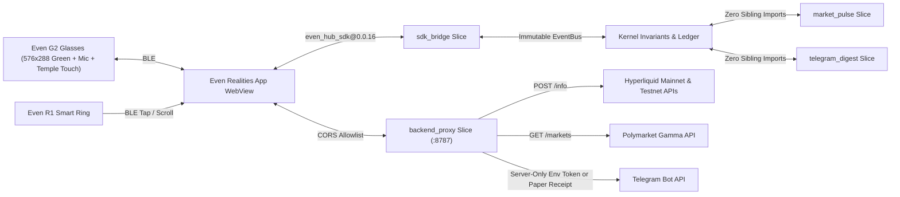

# HeadsUp Pulse — Even Realities G2 Read-and-Write Companion

HeadsUp Pulse connects priority Telegram channels and work groups with live Hyperliquid and Polymarket market intelligence inside a single `576 x 288` monochrome green optical workflow for Even Realities G2 smart glasses.

Built for **Heads Up: Even Realities Hackathon by TVM Ventures & Daos Hub (`#2477`)** across two connected tracks:
- **Track 02 — Crypto & DeFi (`4799`):** Live Hyperliquid perpetual pricing (`api.hyperliquid.xyz/info` and `api.hyperliquid-testnet.xyz/info`) plus live Polymarket Gamma contract odds (`gamma-api.polymarket.com/markets`), paired with 1-tap paper/testnet hedge confirmations from the R1 Ring or temple touch bar.
- **Track 01 — Messaging & News (`4795`) + Special Prize (`Best Telegram Integration`):** Allowlist-only Telegram channel and group compression (`<= 4` short lines for a 30-second glance) with 1-tap AI draft approval or push-to-talk voice replies routed through a local CORS-whitelisted backend proxy.

---

## System Architecture



### Vertical-Slice Code Topology

1. `src/kernel/event_bus.mjs`: Enforces physical Even G2 optical invariants (`576x288` bounds, `<= 4` lines, `<= 44` chars/line, integer `textColor` brightness `0..4`, `PAPER_TRADING_ONLY = true`) and provides an append-only frozen `EventBus`.
2. `src/features/sdk_bridge/index.mjs`: Integrates `@evenrealities/even_hub_sdk@0.0.16` (`waitForEvenAppBridge`, `createStartUpPageContainer`, `textContainerUpgrade`, `rebuildPageContainer`, `audioControl`, `imuControl`, `onEvenHubEvent`, and `validateEvenHubPageContainer`), plus a deterministic `flutter_inappwebview` host adapter for Node tests and standalone desktop browsers.
3. `src/features/market_pulse/index.mjs`: Queries live Hyperliquid perp mark prices, hourly funding rates, Testnet mid prices, L2 order-book depth (`l2Book` VWAP slippage preview), and Polymarket active contract probabilities with deterministic offline fallback and 1-tap paper/testnet order receipts.
4. `src/features/telegram_digest/index.mjs`: Parses live Telegram Bot API `getUpdates` streams (`normalizeTelegramBotUpdates`, offset deduplication) plus local feeds, filters strictly to user-selected Telegram handles (`@HyperliquidAlphaDesk`, `@DaosHubDubai`, `@EvenBuildersOps`), drops unselected group noise, and stages 1-tap AI or voice replies.
5. `src/features/backend_proxy/index.mjs`: Serves `web/index.html`, `app.json`, and CORS-protected JSON endpoints (`/api/health`, `/api/pulse`, `/api/telegram/poll`, `/api/market/l2-preview`, `/api/action/confirm`, `/api/telegram/reply-draft`, `/api/stt/transcribe`) while keeping optional credentials strictly in server memory.

---

## Reproducible Setup & Verification

### Prerequisites
- Node.js `>= 20.0.0` (tested on Node `22+` / Homebrew Node)
- Optional for hardware/simulator testing: `@evenrealities/evenhub-cli` and `@evenrealities/evenhub-simulator`

### 1. Install Dependencies
```bash
npm install
```

### 2. Generate Live Session Evidence Bundle
Fetches live Hyperliquid and Polymarket feeds, validates all 4 `EvenHubPageContainer` frames through `@evenrealities/even_hub_sdk@0.0.16`, runs R1 Ring and voice reply flows, and writes `outputs/live_session_bundle.json`:
```bash
node src/cli.mjs
```

### 3. Start Local Backend Proxy & 576x288 Waveguide Workbench
```bash
node src/cli.mjs --serve --port 8787
```
Open `http://127.0.0.1:8787` in a desktop browser or point `@evenrealities/evenhub-simulator` at `http://127.0.0.1:8787`.

To enable live outbound Telegram Bot API delivery (optional; defaults to deterministic local paper-delivery receipts when unset):
```bash
TELEGRAM_BOT_TOKEN="<your_bot_token>" TELEGRAM_DEFAULT_CHAT_ID="<your_chat_id>" node src/cli.mjs --serve --port 8787
```

### 4. Run Automated Test Suite
```bash
npm test
```

---

## Money-Safety, Privacy & Key Hygiene Notice

- **Strictly Paper / Testnet / Read-Only:** Every market action in HeadsUp Pulse executes as a non-custodial paper or Hyperliquid Testnet simulation (`executionMode: "PAPER_TESTNET_ONLY"`, `realFundsAtRiskUsd: 0`). Attempts to pass `liveMainnetExecution: true` or `custodyUserFunds: true` are rejected by the kernel safety gate and HTTP `403` proxy lock.
- **Zero Custody & Zero Financial Advice:** HeadsUp Pulse displays user-requested market telemetry and stages user-confirmed simulation tickets without holding wallets, private keys, or user funds, and provides no financial advice.
- **Zero Client Secrets:** No API tokens, private keys, or `.env` files exist in client bundles or repository commits.
- **Allowlist Privacy:** Only explicitly selected Telegram handles enter the 4-line digest; unselected personal chats are discarded before rendering.

---

## Pre-Nov-23 Open-Source, Scaffold & API Disclosure

In compliance with Hackathon `#2477` rules (*"has disclosed in the README any code that existed before"* and *"Open-source libraries and existing APIs are allowed; say in your README what existed before Nov 23"*):
- **Pre-existing external open-source packages & fonts:**
  - `@evenrealities/even_hub_sdk@0.0.16` (MIT License, Even Realities official WebView TypeScript/JavaScript SDK)
  - Node.js standard library (`node:http`, `node:test`, `node:assert`, `node:crypto`, `node:fs`)
  - SIL Open Font License 1.1 web fonts (`Inter`, `Instrument Serif`, `JetBrains Mono`)
- **Pre-existing public APIs:**
  - Hyperliquid Mainnet & Testnet Info HTTP endpoints (`https://api.hyperliquid.xyz/info`, `https://api.hyperliquid-testnet.xyz/info`)
  - Polymarket Gamma Markets REST endpoint (`https://gamma-api.polymarket.com/markets`)
  - Telegram Bot HTTP API (`https://api.telegram.org`)
- **Pre-existing local builder quality linters (not part of the runtime app):**
  - Local static CSS/HTML accessibility and DoraHacks Build markdown preflight validators used during development verification.
- **Pre-Nov-23 initial repository scaffold (`commits b563869..7d7322e`, `2026-11-21` to `2026-11-22 UTC`):**
  - Initial repository layout (`app.json`, `EventBus` optical/safety invariants, Even Hub SDK `0.0.16` WebView host adapter, local `576x288` Dark Studio simulator shell, baseline market/Telegram feeds, and demo walkthrough media) prepared prior to `2026-11-23T08:00:00Z`.
- **Nov 23 (`2026-11-23 UTC`) Hackathon Feature Engineering:**
  - Added live Telegram Bot API `getUpdates` priority channel/group ingestion (`normalizeTelegramBotUpdates`, `ingestBotApiUpdates`, `pollTelegramUpdates`, and `POST /api/telegram/poll` with update-offset deduplication and server-only token isolation), Hyperliquid L2 order-book VWAP and slippage preview (`simulateL2OrderBookImpact`, `previewL2OrderImpact`, and `POST /api/market/l2-preview`) attached to Even R1 Ring 1-tap paper hedge tickets, and expanded end-to-end automated tests (`7/7` passing).

---

## Five Concrete API Feature Requests for Ecosystem Teams

1. **Even Hub SDK (`@evenrealities/even_hub_sdk`) — Glyph Pixel-Width Measurement Helper:** `textContainerUpgrade` accepts UTF-8 strings for `576x288` containers without exposing proportional glyph advance widths on G2 firmware, requiring conservative character caps (`44` chars/line). Adding `measureGlassesTextWidth(text, containerWidth)` or a fixed-width monospace font flag on `TextContainerProperty` would prevent unexpected line wraps on dense numeric tickers.
2. **Even Hub SDK (`@evenrealities/even_hub_sdk`) — Non-Audio Confirmation Micro-Pulse Primitive:** Because Even G2 omits speakers by design, 1-tap order or reply confirmations rely on text changes alone. Adding a lightweight `flashContainerAck(containerID, durationMs)` firmware primitive would confirm R1 Ring taps in `<80 ms` without full container text rewrites.
3. **Telegram API — Scoped Read-Only Channel Digest Token via Pairing Code:** Reading a user's followed channels inside a mobile WebView currently requires either adding a custom bot to each channel or holding a full MTProto user session. A narrow, revocable `channels:read_digest` pairing-code token would let wearable companions summarize chosen channels safely without full account privileges.
4. **Hyperliquid API — Unsigned `/info` Order Impact & Slippage Simulator:** Adding `{"type": "simulateOrder", "coin": "BTC", "isBuy": false, "sz": "0.01"}` on the read-only `/info` endpoint to return exact L2 VWAP fill price and fee impact without an L1 wallet signature would let smart-glass companions preview real book depth prior to phone-side signing.
5. **Polymarket Gamma API — Lightweight Delta SSE Stream for Watched Contracts:** Polling `gamma-api.polymarket.com/markets` transfers full market descriptions and media URLs on every refresh. A compact Server-Sent Events stream emitting `{ id, yesPrice, noPrice, volume24hr }` deltas for 3–5 watched market IDs would cut mobile WebView bandwidth and BLE wakeups on paired eyewear.
