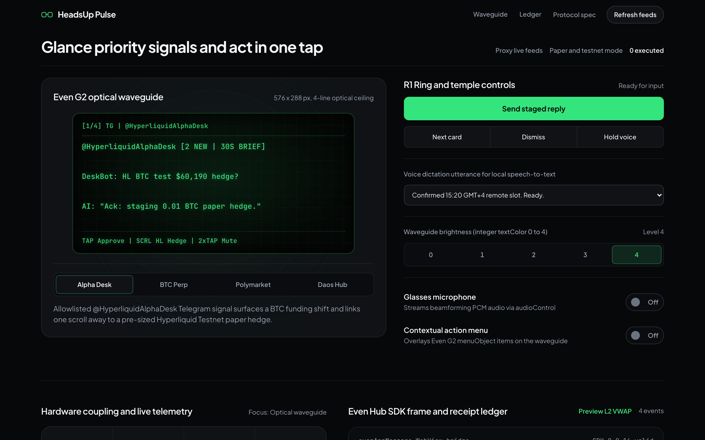
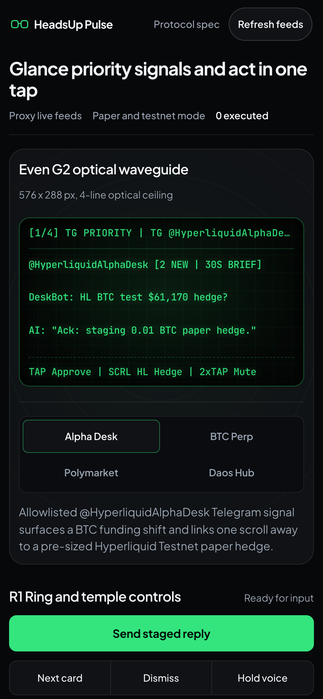
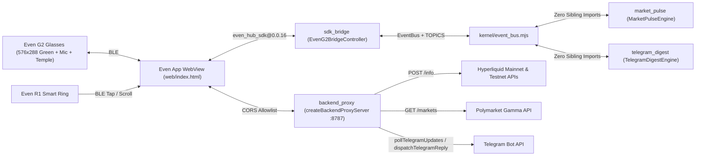

# HeadsUp Pulse — Even Realities G2 Read-and-Write Companion

HeadsUp Pulse links priority Telegram channels with live Hyperliquid and Polymarket telemetry inside a `576 x 288` monochrome green optical workflow for Even Realities G2 smart glasses.

Built for **Heads Up: Even Realities Hackathon by TVM Ventures & Daos Hub (`#2477`)** across two connected tracks and one special prize:
- **Track 01 — Messaging & News (`4795`) + Special Prize (`Best Telegram Integration`):** Allowlist-only Telegram digest (`<= 4` short lines) with 1-tap AI draft approval or push-to-talk voice replies.
- **Track 02 — Crypto & DeFi (`4799`):** Live Hyperliquid perpetual pricing, hourly funding, Testnet mids, `l2Book` VWAP slippage previews, and Polymarket Gamma odds with 1-tap paper hedge confirmations.

**Demo Video (`<= 3` min H.264 MP4):** [Watch locally (`outputs/demo_walkthrough.mp4`)](outputs/demo_walkthrough.mp4) | [Direct Raw GitHub Video](https://raw.githubusercontent.com/HindsightWise/headsup-pulse-even-g2/main/outputs/demo_walkthrough.mp4)

---

## Visual Previews (576x288 Dark Studio Optical Workbench)

| Desktop Workbench (`1440 x 900`) | Mobile Companion (`428 x 926`) |
| :--: | :--: |
|  |  |

---

## Why It Matters on Even G2 (Usefulness & Display/Voice UX)

Active traders and builders constantly pull out their phones during meetings or transit to check Telegram alerts, funding shifts, or prediction odds. Phone dashboards crowd `576 x 288` monochrome eyewear, while passive notification mirrors block fast replies.

HeadsUp Pulse turns that daily check into a 30-second eyes-up loop:
1. **Strict optical budget:** Every frame fits `576 x 288` pixels with `<= 4` lines, `<= 44` characters per line, and integer `textColor` brightness `0..4`.
2. **Allowlist signal filter:** Only user-picked Telegram handles (`@HyperliquidAlphaDesk`, `@DaosHubDubai`, `@EvenBuildersOps`) render on G2; noisy groups drop before display.
3. **One-scroll bridge:** A funding alert on Card 01 links one R1 Ring scroll away to a pre-sized Hyperliquid Testnet paper hedge on Card 02.
4. **Silent, speakerless voice UX:** Glasses beamforming mic (`AudioInputSource.Glasses`) tags `speakerRole: "self"` and `direction`, routes audio to `/api/stt/transcribe`, and previews the reply on G2 before 1-tap send.

---

## Read-and-Write Interaction Matrix

### Deck Cards (`01..04`)

| Card | Card ID & Track | Read Surface (`576 x 288`) | Write Action | Backend Endpoint & SDK Path |
| :-- | :-- | :-- | :-- | :-- |
| **01** | `card-tg-alpha-bridge` (Track 01 `4795`, Best Telegram) | `@HyperliquidAlphaDesk` 30-second brief with live BTC Testnet mid hint | 1-tap approve AI reply, scroll to Card 02 hedge, or double-tap mute 1h | `POST /api/telegram/poll`, `POST /api/telegram/reply-draft` + `createStartUpPageContainer` / `textContainerUpgrade` |
| **02** | `card-hl-btc-hedge` (Track 02 `4799`) | Live Hyperliquid `BTC-PERP` mark, 24h delta, Testnet mid, funding, OI, and `l2Book` VWAP preview | 1-tap confirm non-custodial paper/testnet hedge or double-tap dismiss | `GET /api/pulse`, `POST /api/market/l2-preview`, `POST /api/action/confirm` + `textContainerUpgrade` |
| **03** | `card-pm-live-odds` (Track 02 `4799`) | Live Polymarket Gamma active contract question, YES/NO odds, and 24h volume | 1-tap confirm `$25.00` zero-custody paper sim ticket or double-tap dismiss | `GET /api/pulse`, `POST /api/action/confirm` + `textContainerUpgrade` |
| **04** | `card-tg-ops-reply` (Track 01 `4795`, Best Telegram) | `@DaosHubDubai` priority ops thread with AI or voice-transcribed draft | Hold for push-to-talk voice reply, 1-tap approve/send, or double-tap mute 1h | `POST /api/stt/transcribe`, `POST /api/telegram/reply-draft` + `audioControl` + `textContainerUpgrade` |

### Hardware Gestures & Controls

| Hardware Control | SDK Event / Call (`@evenrealities/even_hub_sdk@0.0.16`) | Runtime Topic / Action | Backend Endpoint |
| :-- | :-- | :-- | :-- |
| **R1 Ring Scroll** | `onEvenHubEvent` -> `SCROLL_BOTTOM_EVENT` / `SCROLL_TOP_EVENT` (`TOUCH_EVENT_FROM_RING`) | Publishes `SCROLL_NEXT` / `SCROLL_PREV` on `TOPICS.GLASSES_INPUT_GESTURE`; upgrades active card via `textContainerUpgrade` | `GET /api/pulse` |
| **R1 Ring Tap** | `onEvenHubEvent` -> `CLICK_EVENT` (`TOUCH_EVENT_FROM_RING`) | Publishes `TAP_CONFIRM`; confirms paper hedge or approves staged Telegram reply | `POST /api/action/confirm` or `POST /api/telegram/reply-draft` |
| **Temple Touch** | `onEvenHubEvent` -> `CLICK_EVENT` / `DOUBLE_CLICK_EVENT` (`TOUCH_EVENT_FROM_GLASSES_R` / `L`) | Single tap confirms; double tap publishes `DOUBLE_TAP_DISMISS` (dismisses ticket or mutes thread 1h) | `POST /api/action/confirm` or `POST /api/telegram/reply-draft` |
| **Push-to-Talk Voice** | `LONG_PRESS_EVENT` -> `audioControl(true, AudioInputSource.Glasses)` -> `audioEvent` PCM frames | Publishes `TOPICS.GLASSES_VOICE_CAPTURED`; stages voice reply or voice paper order | `POST /api/stt/transcribe` |
| **Brightness `0..4`** | `clampBrightness(level)` -> `textContainerUpgrade({ textColor })` | Sets integer `textColor` (`0..4`) on `hud-header` and `hud-body` containers | Local WebView + `createHeadsUpPulseRuntime.setBrightness` |
| **Contextual `menuObject`** | `menuObject.menuItems` (`1..4`, `<= 32` UTF-8 bytes) -> `menuItemClickEvent` | Maps item IDs `1..4` to `TAP_CONFIRM`, `DOUBLE_TAP_DISMISS`, `VOICE_PTT_TOGGLE`, `SCROLL_NEXT` | Dispatches active card action endpoint |

---

## System Architecture



### Vertical-Slice Code Topology

1. `src/kernel/event_bus.mjs`: Exports `getG2Invariants`, `clampBrightness`, `formatGlanceLines`, `validateG2CardSpec`, `assertPaperTradingSafety`, `TOPICS`, and immutable `EventBus`.
2. `src/features/sdk_bridge/index.mjs`: Exports `installMockFlutterWebViewHost`, `loadEvenHubSdk`, `buildEvenG2PageContainer`, `assertStrictPageContainerContract`, and `EvenG2BridgeController` over `@evenrealities/even_hub_sdk@0.0.16`.
3. `src/features/market_pulse/index.mjs`: Exports `MarketPulseEngine` and `simulateL2OrderBookImpact` for live Hyperliquid `metaAndAssetCtxs`, `allMids`, `l2Book` VWAP slippage previews, and Polymarket Gamma odds.
4. `src/features/telegram_digest/index.mjs`: Exports `TelegramDigestEngine` and `normalizeTelegramBotUpdates` for allowlist-only Telegram Bot API `getUpdates` ingestion, offset deduplication, and 1-tap AI or voice replies.
5. `src/features/backend_proxy/index.mjs`: Exports `loadAppManifest`, `isOriginAllowed`, `isUpstreamWhitelisted`, `dispatchTelegramReply`, `pollTelegramUpdates`, and `createBackendProxyServer` serving `/api/health`, `/api/pulse`, `/api/telegram/poll`, `/api/market/l2-preview`, `/api/action/confirm`, `/api/telegram/reply-draft`, and `/api/stt/transcribe`.
6. `src/app.mjs` & `src/cli.mjs`: Export `createHeadsUpPulseRuntime` and `generateLiveSessionBundle` to compose all four vertical slices without sibling cross-imports.

---

## Reproducible Setup & Verification

### Prerequisites
- Node.js `>= 20.0.0` (verified on Node `22+`).
- Optional hardware/simulator tooling: `@evenrealities/evenhub-cli` and `@evenrealities/evenhub-simulator`.

### Four-Step Local Verification

1. **Install dependencies:**
```bash
npm install
```

2. **Generate live session evidence bundle (`outputs/live_session_bundle.json`):**
```bash
node src/cli.mjs
```

3. **Start the local CORS-whitelisted proxy and `576x288` optical workbench:**
```bash
node src/cli.mjs --serve --port 8787
```
Open `http://127.0.0.1:8787` in a browser or point `@evenrealities/evenhub-simulator` at `http://127.0.0.1:8787`.

To enable live Telegram Bot API polling and outbound message delivery (optional; defaults to deterministic local paper receipts when unset):
```bash
TELEGRAM_BOT_TOKEN="<your_bot_token>" TELEGRAM_DEFAULT_CHAT_ID="<your_chat_id>" node src/cli.mjs --serve --port 8787
```

4. **Run the automated test suite (`7/7` passing):**
```bash
npm test
```

Verified suite coverage in `tests/headsup_pulse.test.mjs`:
- Test 1: Kernel optical invariants (`576x288`, `<= 4` lines, `<= 44` chars, brightness `0..4`), paper-only safety lock, and frozen `EventBus` ledger.
- Test 2: Static AST boundary check proving zero sibling imports across all four vertical slices.
- Test 3: Official `@evenrealities/even_hub_sdk@0.0.16` lifecycle, `zOrderIndex` validation, `textColor` `0..4`, microphone PCM frames, and R1 Ring / menu events.
- Test 4: Dual-track `MarketPulseEngine` and `TelegramDigestEngine` noise filtering, voice reply staging, and paper order receipts.
- Test 5: Real TCP HTTP proxy, CORS origin rejection (`403`), live-mainnet safety rejection (`403`), BYO-STT, and zero-leak server-side `TELEGRAM_BOT_TOKEN` routing.
- Test 6: `live_session_bundle.json` container validation, Dark Studio UI artistry gate (`M >= 0.68`), DoraHacks Build preflight (`0` errors / `0` warnings), and prose hygiene.
- Test 7: Live Telegram `getUpdates` offset deduplication, Hyperliquid Testnet `l2Book` VWAP slippage preview, and `POST /api/market/l2-preview` safety lock (`403`).

---

## Business Potential & Safety Model

### Commercial Path
- **Even Hub Catalogue Distribution:** Ship as a freemium `.ehpk` companion for active crypto operators, founders, and trading desks wearing Even G2.
- **Pro Desk Tier:** Offer paid priority alert routing, custom allowlist rules, and multi-venue L2 liquidity previews while keeping the core 4-line digest free.
- **Non-Custodial Handoff:** Stage paper preview tickets on G2 and hand off optional execution approval to phone-side wallets without storing keys on eyewear.

### Money-Safety, Privacy & Key Hygiene Notice
- **Strictly Paper / Testnet / Read-Only:** Every market action runs as a non-custodial simulation (`executionMode: "PAPER_TESTNET_ONLY"`, `realFundsAtRiskUsd: 0`). Any request with `liveMainnetExecution: true` or `custodyUserFunds: true` triggers `assertPaperTradingSafety` and an HTTP `403` `SAFETY_LOCK_REJECTED` response.
- **Zero Custody & Zero Financial Advice:** HeadsUp Pulse renders user-selected market telemetry and simulation tickets without holding wallets, private keys, or funds, and gives no financial advice.
- **Allowlist Privacy:** Unselected Telegram chats drop before digest creation; only user-picked priority handles reach the G2 waveguide.
- **Zero Client Secrets:** No API tokens, private keys, or `.env` files exist in client code or repository commits. Optional `TELEGRAM_BOT_TOKEN` stays strictly in server memory.

---

## Pre-Nov-23 Open-Source, Scaffold & API Disclosure

In compliance with Hackathon `#2477` rules (*"has disclosed in the README any code that existed before"* and *"say in your README what existed before Nov 23"*):
- **Pre-existing external open-source packages & fonts:**
  - `@evenrealities/even_hub_sdk@0.0.16` (MIT License, official Even Realities WebView SDK).
  - Node.js built-in modules (`node:http`, `node:test`, `node:assert`, `node:crypto`, `node:fs`).
  - SIL Open Font License 1.1 web fonts (`Inter`, `Instrument Serif`, `JetBrains Mono`).
- **Pre-existing public APIs:**
  - Hyperliquid Mainnet & Testnet Info HTTP endpoints (`https://api.hyperliquid.xyz/info`, `https://api.hyperliquid-testnet.xyz/info`).
  - Polymarket Gamma Markets REST endpoint (`https://gamma-api.polymarket.com/markets`).
  - Telegram Bot HTTP API (`https://api.telegram.org`).
- **Pre-existing local builder validators (development only, outside runtime):**
  - Static UI artistry and DoraHacks Build markdown preflight validators run during local testing.
- **Pre-Nov-23 initial repository scaffold (`commits b563869..7d7322e`, `2026-11-21` to `2026-11-22 UTC`):**
  - Initial repository layout (`app.json`, `EventBus` optical/safety invariants, Even Hub SDK `0.0.16` WebView host adapter, `576x288` Dark Studio simulator shell, baseline feeds, and initial demo media) prepared before `2026-11-23T08:00:00Z`.
- **Nov 23+ (`2026-11-23 UTC` onward) Hackathon Feature Engineering:**
  - Built live Telegram Bot API `getUpdates` polling (`normalizeTelegramBotUpdates`, `ingestBotApiUpdates`, `pollTelegramUpdates`, `POST /api/telegram/poll` with offset deduplication), Hyperliquid `l2Book` VWAP slippage simulation (`simulateL2OrderBookImpact`, `previewL2OrderImpact`, `POST /api/market/l2-preview`), expanded `7/7` automated tests, upgraded demo walkthrough, and judge-ready documentation.

---

## AI-Assisted Coding Disclosure

Per organizer `danel` in DoraHacks Q&A `#1562275` (*"Yes, AI-assisted coding is fine. Mention it in the README."*): AI coding assistants were used during development to draft code modules, refactor tests, and tighten documentation. All architecture boundaries, `@evenrealities/even_hub_sdk@0.0.16` container contracts, live API integrations, and automated verification suites were reviewed and executed by the author.

---

## Five Concrete API Feature Requests for Ecosystem Teams

1. **Even Hub SDK (`@evenrealities/even_hub_sdk`) — Glyph Pixel-Width Helper:** `textContainerUpgrade` accepts UTF-8 strings for `576x288` containers without exposing firmware glyph advance widths, forcing conservative `44`-character caps. Exposing `measureGlassesTextWidth(text, containerWidth)` or a monospace flag on `TextContainerProperty` would prevent unexpected wraps on numeric tickers.
2. **Even Hub SDK (`@evenrealities/even_hub_sdk`) — Optical Confirmation Micro-Pulse:** Even G2 omits speakers, so 1-tap confirmations rely on full text rewrites. Adding a lightweight `flashContainerAck(containerID, durationMs)` primitive would confirm R1 Ring taps in `< 80 ms` with minimal BLE traffic.
3. **Telegram API — Scoped Read-Only Digest Pairing Token:** Reading followed channels in a WebView currently requires adding a bot per channel or holding a full MTProto user session. A revocable `channels:read_digest` pairing-code token would let wearable companions summarize chosen channels safely without full account privileges.
4. **Hyperliquid API — Unsigned `/info` Order Impact Endpoint:** Adding `{"type": "simulateOrder", "coin": "BTC", "isBuy": false, "sz": "0.01"}` on `/info` to return exact L2 VWAP fill price and fee impact without an L1 signature would let smart glasses preview book depth before phone signing.
5. **Polymarket Gamma API — Compact Delta SSE Stream:** Polling `gamma-api.polymarket.com/markets` returns full descriptions and media URLs on every refresh. A lightweight SSE stream emitting `{ id, yesPrice, noPrice, volume24hr }` deltas for watched market IDs would cut mobile WebView bandwidth and BLE wakeups.
